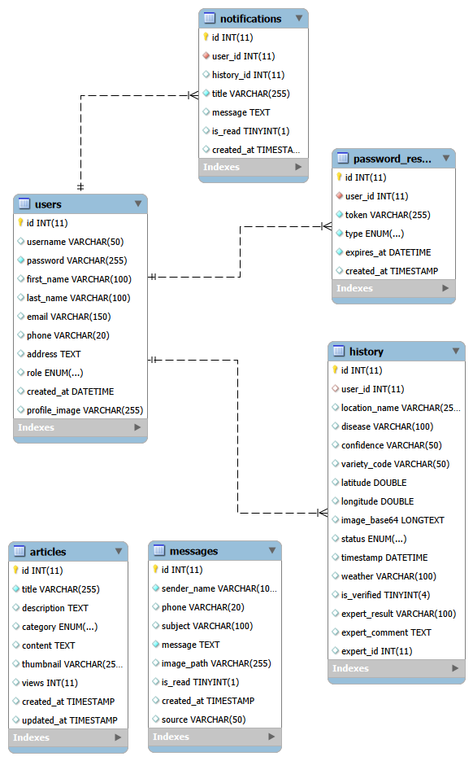

# 🌾 Rice AI Analysis (ระบบวินิจฉัยโรคข้าวด้วย AI)
เว็บแอปพลิเคชันสำหรับเกษตรกรเพื่อใช้วิเคราะห์โรคข้าวจากรูปภาพใบข้าว โดยใช้ Deep Learning ในการประมวลผล 

## 👥  สมาชิกกลุ่ม 

| รหัสนิสิต | ชื่อ - นามสกุล | ตำแหน่ง |
| --------------- | --------------- | --------------- |
67022074 | นาย ภูธฤทธิ์ บุญแรง | BACKEND DEV.
67021387 | นาย กนกศักดิ์ อุปสุขิน| FRONTEND DEV. 
67021804 | นาย ธีรดนย์ ชะนันพล | FRONTEND DEV. 
67021400 | นาย กาณฑ์ ปัญญาวงค์ | FRONTEND DEV. 
67074133 | นางสาว ประภัสสร เจตะนา  | FRONTEND DEV. 


## ✨ ฟีเจอร์หลัก (Key Features)
- **AI Disease Detection:** วิเคราะห์โรคข้าวด้วยโมเดลที่เทรนจาก **Google Teachable Machine** 
- **Real-time Prediction:** รองรับการอัปโหลดรูปภาพและประมวลผลทันที
- **Expert Consultation:** ระบบส่งต่อเคสไปยังผู้เชี่ยวชาญหากผลวิเคราะห์ไม่ชัดเจน
- **User System:** ระบบสมาชิกพร้อม Dashboard สำหรับดูประวัติการตรวจย้อนหลัง
- **Knowledge Base:** คลังความรู้เกี่ยวกับโรคข้าวและการดูแลรักษา

## 🛠️ เทคโนโลยีที่ใช้ (Tech Stack)

โปรเจกต์นี้ทำงานแบบ **Hybrid** โดยแบ่งการทำงานเป็น 2 ส่วนหลัก:

### 1. Web Server & Frontend (Node.js)
- **Framework:** Express.js
- **View Engine:** HTML
- **Styling:** Tailwind CSS (via PostCSS)
- **Database:** MySQL (เชื่อมต่อผ่าน `mysql2`)
- **Tools:** Multer (Upload), Nodemailer (Email), Bcrypt (Security)

### 2. AI & Machine Learning
- **Model Training:** Google Teachable Machine
- **Model Type:** TensorFlow (Keras .h5)
- **Image Processing:** Pillow, NumPy
- **API Service:** Python (FastAPI/Uvicorn)

---

## DATABASE SCHEMA 



## ⚙️ การติดตั้ง (Installation Guide)

### 1. Clone Project
** เปิด PowerShell 
```bash
git clone https://github.com/RIchardIDE/rice-ai-web.git
```
### 2. Install SQL
import rice_ai.sql<br>
เปิด query run  3 คำสั่งนี้<br>
2.1 <br>
```bash
DROP USER IF EXISTS 'rice_admin'@'localhost';

CREATE USER 'rice_admin'@'localhost' IDENTIFIED BY 'rice1234';

GRANT ALL PRIVILEGES ON rice_ai.* TO 'rice_admin'@'localhost';

FLUSH PRIVILEGES;
```
2.2 สมาชิก รหัสคือ 1234 ทั้งหมด<br>
🔑 ข้อมูลสำหรับ Login ทดสอบระบบ<br>
  Admin: admin / 1234<br>
  Expert: doctor1 / 1234<br>
  Farmer: farmer1 / 1234<br>

```bash
INSERT INTO `users` (`id`, `username`, `password`, `first_name`, `last_name`, `email`, `phone`, `address`, `role`, `created_at`, `profile_image`) VALUES
(1, 'admin', '$2a$12$PU5VszXO3UCJ4tM0t.5ePOa6QD6I0zmFa2biuVMFvz9r9gVIUWyDi', 'System', 'Administrator', 'admin@riceai.com', NULL, NULL, 'admin', '2026-02-08 22:24:00', NULL),
(2, 'doctor1', '$2a$12$PU5VszXO3UCJ4tM0t.5ePOa6QD6I0zmFa2biuVMFvz9r9gVIUWyDi', 'Rice', 'Expert', 'doctor1@riceai.com', NULL, NULL, 'expert', '2026-02-08 22:24:00', NULL),
(3, 'farmer1', '$2a$12$PU5VszXO3UCJ4tM0t.5ePOa6QD6I0zmFa2biuVMFvz9r9gVIUWyDi', 'Somchai', 'Farmer', 'somchai@gmail.com', NULL, NULL, 'farmer', '2026-02-08 22:24:00', NULL);
```
2.3 คลังความรู้
```bash
INSERT INTO articles (id, title, description, category, content, thumbnail, views, created_at) VALUES

(1, 'โรคไหม้ (Blast Disease)', 'เกิดจากเชื้อรา Pyricularia oryzae ทำให้ใบมีแผลรูปตา สีเทาขอบน้ำตาล ส่งผลให้ผลผลิตเสียหาย', 'disease', '<p><b>ลักษณะอาการ:</b><br>

ระยะกล้า ใบมีแผลจุดสีน้ำตาลคล้ายรูปตา ตรงกลางแผลมีสีเทา<br>

ระยะแตกกอ อาการรุนแรงจะทำให้ใบแห้งตายทั้งกอ คล้ายถูกไฟไหม้<br>

ระยะออกรวง ถ้าเชื้อเข้าทำลายที่คอรวง จะทำให้คอรวงเน่า แห้งเปราะหักง่าย รวงข้าวลีบสีขาว</p>


<p><b>การป้องกันกำจัด:</b><br>

1. ใช้พันธุ์ต้านทานโรค<br>

2. หว่านเมล็ดพันธุ์ในอัตราที่เหมาะสม ไม่แน่นเกินไป<br>

3. ลดการใช้ปุ๋ยไนโตรเจนสูงเกินไป<br>

4. ฉีดพ่นสารป้องกันกำจัดเชื้อรา เช่น ไตรไซคลาโซล</p>', 'article-1770717926577-315238075.jpg', 4, '2026-02-10 17:00:00'),

(2, 'เทคนิคใส่ปุ๋ยยูเรีย: เร่งต้น แตกกอ ไม่ง้อโรค', 'ปุ๋ยไนโตรเจนสูงที่เป็นเหมือน "ดาบสองคม" หากใช้ถูกวิธีข้าวจะแตกกอดี ใบเขียวตั้ง แต่หากใช้มากเกินไปในช่วงเวลาผิด อาจเป็นการเรียกหนอนและเชื้อราเข้าแปลงนา', 'fertilizer', '<p><b>ปุ๋ยยูเรีย (46-0-0) คืออะไร?</b>


คือปุ๋ยเคมีที่มีปริมาณไนโตรเจนสูงถึง 46% เป็นธาตุอาหารหลักที่พืชต้องการเพื่อสร้างคลอโรฟิลล์ (สารสีเขียว) ช่วยให้ลำต้นและใบเจริญเติบโตอย่างรวดเร็ว</p>


<p><b>ช่วงเวลาทองของการใส่ปุ๋ยยูเรีย:</b>


ควรใส่ในช่วง <b>"ข้าวระยะแตกกอ"</b> (ประมาณ 20-30 วันหลังหว่าน) เพื่อช่วยเพิ่มจำนวนต้นต่อกอ ยิ่งแตกกอเยอะ ผลผลิตยิ่งมีโอกาสเพิ่มขึ้น</p>


<p><b>ข้อควรระวัง (สำคัญมาก!):</b>

การใส่ปุ๋ยยูเรียมากเกินไป ("ข้าวบ้าใบ") จะทำให้:


1.ใบข้าวอวบน้ำ สีเขียวเข้มจัด ผนังเซลล์อ่อนแอ

2.ล่อแมลงศัตรูพืช เช่น เพลี้ยกระโดดสีน้ำตาล

3.เสี่ยงต่อ <b>โรคไหม้</b> และโรคขอบใบแห้งได้ง่ายขึ้น


<i>*แนะนำให้ใส่สลับกับปุ๋ยตัวหน้าต่ำในช่วงข้าวตั้งท้อง เพื่อเน้นบำรุงเมล็ดแทนใบ</i></p>', 'article-1770719349415-150129124.JPG', 1, '2026-02-10 17:00:00'),

(3, 'เทคนิคแกล้งข้าว (เปียกสลับแห้ง)', 'วิธีการบริหารจัดการน้ำแบบใหม่ "AWD" ไม่ต้องขังน้ำตลอดเวลา ช่วยให้รากข้าวแข็งแรง ลดก๊าซเรือนกระจก และลดการระบาดของเพลี้ยกระโดด', 'care', 'p><b>ทำไมต้อง "เปียกสลับแห้ง"?</b>


ตามธรรมชาติ ชาวนามักขังน้ำไว้ในนาตลอดเวลา แต่จริงๆ แล้วข้าวไม่ได้ต้องการน้ำท่วมขังตลอด การปล่อยให้น้ำแห้งบ้างจะกระตุ้นให้ <b>"รากข้าวต้องหยั่งลึกลงดิน"</b> เพื่อหาน้ำ ทำให้ต้นข้าวแข็งแรง ไม่ล้มง่าย</p>


<p><b>วิธีการทำท่อดูระดับน้ำ (ท่อแกล้งข้าว):</b>

1.ใช้ท่อ PVC ยาว 25 ซม. เจาะรูรอบๆ ในส่วนล่าง

2.ฝังลงดินให้เหลือส่วนบนโผล่พ้นดิน 5 ซม.

3.เมื่อระดับน้ำในท่อลดลงต่ำกว่าผิวดิน 15 ซม. ให้เริ่มสูบน้ำเข้านาใหม่</p>


<p><b>ข้อดีที่คุณอาจไม่รู้:</b>

- <b>ประหยัดน้ำ:</b> ลดการใช้น้ำได้ถึง 30-50%

- <b>ลดศัตรูพืช:</b> สภาพดินที่แห้งแตกระแหงบ้าง จะช่วยตัดวงจรชีวิตของ "เพลี้ยกระโดดสีน้ำตาล" ที่ชอบความชื้นแฉะ

- <b>เพิ่มผลผลิต:</b> เมื่อรากแข็งแรง ข้าวก็ดูดสารอาหารได้เก่งขึ้น</p>', 'article-1770719451423-15876911.JPG', 2, '2026-02-10 17:00:00'),

(4, 'เพลี้ยกระโดดสีน้ำตาล (Brown Planthopper)', 'ศัตรูตัวฉกาจอันดับ 1 ดูดน้ำเลี้ยงจนข้าวแห้งตายเป็นหย่อมๆ เหมือนถูกไฟไหม้ แถมยังเป็นพาหะนำโรคใบหงิกมาสู่ข้าว', 'pest', '<p><b>ทำไมถึงน่ากลัว?</b>


เพลี้ยกระโดดสีน้ำตาลจะดูดกินน้ำเลี้ยงที่โคนต้นข้าว ทำให้ต้นข้าวเหลืองแห้งและตายในที่สุด เรียกว่าอาการ <b>"Hopper Burn"</b> (ข้าวไหม้) และที่สำคัญ มันเป็นพาหะนำเชื้อไวรัสทำให้เกิด <b>"โรคใบหงิก (จู๋)"</b> และ <b>"โรคเขียวเตี้ย"</b></p>

<p><b>สาเหตุการระบาด:</b>

1.ปลูกข้าวพันธุ์เดิมซ้ำๆ ไม่พักดิน

2.ใช้ปุ๋ยยูเรีย (ไนโตรเจน) มากเกินไป ทำให้ต้นข้าวอวบน้ำ เปลือกบาง เพลี้ยชอบ

3.ใช้สารเคมีกำจัดแมลงผิดประเภท ทำให้ "แมลงศัตรูธรรมชาติ" (เช่น แมงมุม, มวนเขียว) ตายหมด</p>

<p><b>การป้องกันและกำจัด:</b>

<ul> <li>หมั่นสำรวจแปลงนาที่โคนกอข้าว</li> <li>ใช้เชื้อรา <b>"บิวเวอเรีย"</b> ฉีดพ่นกำจัด</li> <li>อนุรักษ์แมงมุมในนาข้าว เพราะแมงมุม 1 ตัว กินเพลี้ยได้วันละหลายตัว</li> </ul></p>', 'article-1770721928379-353666243.webp', 1, '2026-02-10 18:00:00');
```

### 2. Install Dependencies 
```bash
npm install
```
### 3. Python Tool
download ให้ติดตั้ง python ver 3.10
```bash
py install 3.10
py -3.10 -m venv venv
# เปิดใช้งาน
.\venv\Scripts\activate

# เช็ค Python
python --version

# ติดตั้ง Library ใหม่
pip install -r requirements.txt
```

#### ถ้าหากใน package.json ยังไม่มีบรรทัดนี้ 
```bash
"start": "concurrently \"npm run server\" \"npm run dev\""
```
ให้copy แล้วนำไปเพิ่มที่ในส่วน scripts ของ package.json

### 4.HOW TO RUN 
เมื่อติดตั้งทุกอย่างแล้วให้ เปิด PowerShell ใหม่ ให้ขึ้น 
```bash
(.venv)PS E:\rice-ai-web> 
# แล้วสั่ง 
npm start 
```
```bash
npm start 
```
### หน้าแรกคือหน้า index.html <br>
### หากเปิดโปรแกรมใหม่ต้องเปิด PowerShell ใหม่ทุกครั้ง <br>
### ถ้า ❌ Database Connection Failed: Access denied for user 'rice_admin'@'localhost' (using password: YES) ให้ query คำสั่ง 2.1 อีกทีครับ


